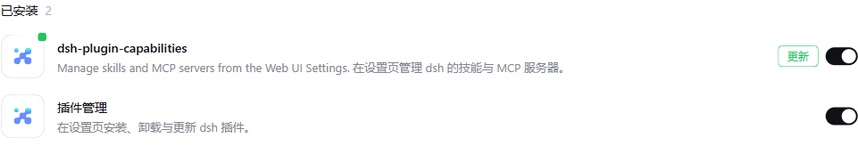

# dsh-plugin-install

[](https://www.npmjs.com/package/dsh-plugin-install)
[](./LICENSE)

dsh 插件页的更新层。dsh 0.2.0 起，官方插件页自带安装、卸载与启停管理，本插件随之收窄为一件事：**让每个插件在原地看见自己的更新**——

- 插件页列表里，有新版本的插件会在图标右上角亮起绿点，启用开关旁出现「更新」按钮；没有更新的插件不显示任何额外元素。更新完成后多数情况原地生效——正在运行的插件被自动摘下再挂上，新代码即刻加载；无法热替换时按钮翻转为「重启」，点击即重启宿主。
- 点进插件详情页，标题旁挂绿色「可更新 x.y.z」标签（github 安装则提示远端有新提交），页首操作区同样提供「更新」。
- 侧栏「插件」导航行上的计数角标仍在：有待更新插件的个数一目了然。



检测规则与更新走的仍是 `dsh plugin add` 这条 CLI 路径：npm 安装的对照 registry 的 latest 版本号，github 安装的对照仓库 HEAD 提交，本地链接则如实标注、不做检查。更新前会核对方向——registry 的 latest 不高于已装版本时拒绝执行，绝不把更新变成降级。每次 add 与 remove 都附带 `--config.minimum-release-age=0`：pnpm 11 默认开启 24 小时发布冷静期，`@latest` 会被静默解析到窗口外的旧版本，发布当天点更新等于原地不动；它还会在每次操作前对整个 lockfile 做策略校验，只要里面有窗口内发布的条目（例如显式钉版安装带进来的传递依赖），安装与卸载会一并被 `ERR_PNPM_MINIMUM_RELEASE_AGE_VIOLATION` 拦死——界面上点名操作的包不受这层默认限制（旧版 pnpm 不认识该参数时自动去掉重试）。更新完成后还会核对实际落地的版本号，与 registry latest 不一致时如实提示，而不是谎报成功。落盘之后尽量原地生效：正在运行的插件会被自动摘下再挂上，宿主的活重组按包名重新解析，pnpm 换盘后的新代码即刻加载，浏览器端刷新一次页面即与新版对齐；热替换不适用时（组合含无法行级停用的行、插件当前未运行、或更新的是本插件自身），按钮翻转为「重启」——桌面宿主里交由壳层重启受监督的 sidecar，独立运行 `dsh web` 时则由插件自行接力：分离的中转进程等旧进程让出端口后按原启动命令拉起新实例，终端场景下再交接回原终端。

安装新插件用插件页自带的「添加插件」；本插件不再提供独立的设置页标签。

## 安装

```sh
dsh plugin --profile web add dsh-plugin-install
```

打开 Web UI 的插件页即可；要求 dsh 0.2.0 或更高版本。卸载执行：

```sh
dsh plugin --profile web remove dsh-plugin-install
```

开发时也可以直接安装本地源码检出：`dsh plugin --profile web add file:/path/to/dsh-plugin-install`，包内的 `prepare` 脚本会自动构建出 `lib/`。

## 安全

写操作设有三重防护：更新目标只能取自已安装清单；POST 请求要求同源——官方桌面壳转发而来的请求没有 Origin 头，仅当回环 Host、回环连接对端、无代理痕迹且无跨站 Sec-Fetch-Site 标记时放行；同一时刻仅允许一个安装、卸载或更新操作运行。服务本身只绑定回环地址，上述措施构成纵深防御。

## 开发

```sh
npm install
npm run typecheck
npm test
npm run build
```

端到端 smoke 默认关闭，要求同级目录下存在 [deepseek-harness](https://github.com/deepseek-ai/deepseek-harness) 源码检出，且 Node ≥ 22.19：

```sh
DSH_DESKTOP_PLUGIN_SMOKE=1 npm test
```

它会创建临时 `DSH_HOME`，将本插件安装进 `web` profile，启动 `dsh web`，并对安装、卸载、取消、更新检查等路由逐一探测。

## 许可

[MIT](./LICENSE)
