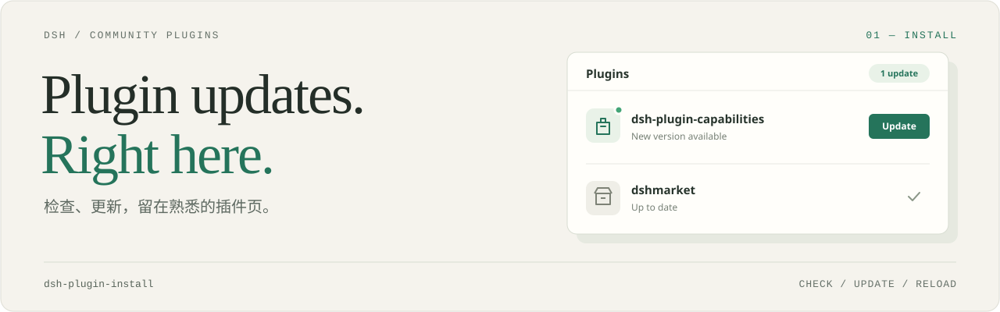

<p align="center">
  
</p>

<h1 align="center">dsh-plugin-install</h1>

<p align="center">
  在熟悉的插件页，完成每一次更新。<br />
  <sub>Plugin updates, right where you need them.</sub>
</p>

<p align="center">
  <a href="https://www.npmjs.com/package/dsh-plugin-install"></a>
  <a href="https://www.npmjs.com/package/dsh-plugin-install"></a>
  <a href="./LICENSE"></a>
</p>

<p align="center">
  <a href="#安装">安装</a> · <a href="#使用">使用</a> · <a href="#更新机制">更新机制</a> · <a href="#开发">开发</a>
</p>

---

为 [DeepSeek Harness](https://github.com/deepseek-ai/deepseek-harness) 的插件页补上更新提示：列表绿点、详情页版本标签，以及一键更新按钮。

dsh 0.2.0 起已自带插件安装、卸载与启停管理，本插件专注于检查和更新，直接融入现有插件页。适用于 `dsh web` 及内嵌该 Web UI 的桌面端。

## 安装

```sh
dsh plugin --profile web add dsh-plugin-install
```

要求 **dsh ≥ 0.2.0**。安装并加载后，打开 **插件** 页面即可使用；添加新插件仍使用页面自带的「添加插件」。

## 使用

<p align="center">
  
</p>

<p align="center"><sub>有更新才显示提示，原有的插件列表保持原样。</sub></p>

| 在哪里 | 会看到什么 |
| :-- | :-- |
| 插件列表 | 有新版的插件亮起绿点，启用开关旁显示「更新」按钮 |
| 插件详情 | 标注可更新版本；GitHub 安装的插件提示远端有新提交 |
| 侧栏导航 | 「插件」旁显示待更新数量 |
| 更新完成后 | 支持热替换时直接生效；否则提供「重启」按钮 |

点击「更新」后，插件会先暂停运行中的目标插件，再替换包并重新挂载。不能安全暂停时会停止操作，提示先重启；更新本插件自身也需要重启。

详情页还提供 **强制卸载**：官方卸载被 pnpm 发布冷静期拦截时，可从这里重试。操作需要两次点击确认；如果运行中的插件无法安全暂停，会拒绝卸载并提示先重启。

## 更新机制

| 安装来源 | 检查依据 |
| :-- | :-- |
| npm | registry 的 `latest` 版本；不高于当前版本时拒绝更新，避免降级 |
| GitHub | 仓库 HEAD 提交 |
| 本地链接 | 标明来源，不检查更新 |

<details>
<summary><strong>版本校验、发布冷静期与热替换</strong></summary>

更新仍通过 `dsh plugin add` 执行，由 dsh CLI 维护 profile。完成后核对实际安装版本，未达到预期版本时会明确提示。

安装与强制卸载会传入 `--config.minimum-release-age=0`，跳过 pnpm 的发布冷静期，避免刚发布的版本被解析成旧版，或整个 lockfile 的策略检查阻断操作。旧版 pnpm 不支持该参数时，会去掉参数重试。遇到发布后 registry 元数据尚未传播的 `ERR_PNPM_NO_VERSIONS`，会延时重试一次。

热替换前先暂停目标插件，释放文件监听等资源，再让宿主按包名重新解析并挂载新代码。浏览器端刷新页面后与新版对齐。组合不支持热替换、插件未运行，或更新本插件自身时，需要重启。

桌面端的重启交给壳层执行；独立运行 `dsh web` 时，由中转进程等待旧进程释放端口，再按原命令启动新实例，页面恢复后自动刷新。

</details>

<details>
<summary><strong>安全与操作范围</strong></summary>

更新目标只能来自已安装清单，同一时刻只允许一个安装、卸载或更新任务。

写操作要求同源 POST。官方桌面壳转发的请求没有 Origin 头时，仅在 Host 与连接对端均为回环地址、没有代理痕迹，且没有跨站 `Sec-Fetch-Site` 标记的条件下放行。

更新会在本机执行第三方包的代码与生命周期脚本。请只更新来源可信的插件。强制卸载跳过的是发布冷静期，仍受运行状态检查约束。

</details>

## 开发

```sh
npm install
npm run typecheck
npm test
npm run build
```

<details>
<summary><strong>本地安装、端到端 smoke 与卸载</strong></summary>

安装本地源码检出，`prepare` 会自动构建 `lib/`：

```sh
dsh plugin --profile web add file:/path/to/dsh-plugin-install
```

端到端 smoke 默认关闭。需要 Node ≥ 22.19，并在同级目录准备已安装依赖的 `deepseek-harness` 源码检出。测试使用临时 `DSH_HOME` 安装插件、启动真实 `dsh web`，探测安装、卸载、取消及更新检查等路由。

```sh
# macOS / Linux
DSH_DESKTOP_PLUGIN_SMOKE=1 npm test
```

```powershell
# Windows PowerShell
$env:DSH_DESKTOP_PLUGIN_SMOKE = '1'
npm test
```

卸载本插件：

```sh
dsh plugin --profile web remove dsh-plugin-install
```

</details>

---

[技能与 MCP 管理](https://github.com/qinyre/dsh-plugin-capabilities) · [反馈问题](https://github.com/qinyre/dsh-plugin-install/issues) · [MIT License](./LICENSE)
